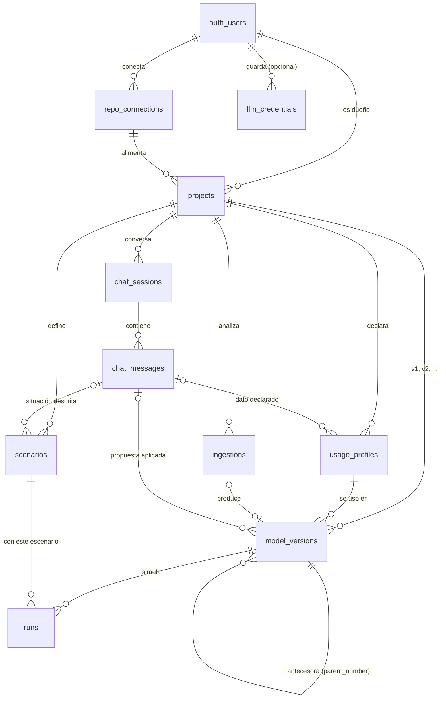

# `app/db`: modelo de datos persistente

Define qué guarda Branchpoint entre sesiones y cómo (JAJ-55). La propuesta original del esquema está en [`schema.sql`](schema.sql). El esquema que se aplica vive en [`supabase/migrations/`](../../../supabase/migrations/) (JAJ-56): cómo levantarlo y cambiarlo está en [`docs/supabase-local.md`](../../../docs/supabase-local.md).

El motor (`app/engine`) no depende de esta carpeta: recibe un modelo y devuelve un `Run`, sin guardar nada.

## Qué hay que recordar

Lo que sale de la investigación:

- **Dos entradas del usuario.**
  - Su **código**: un repo de GitHub (JAJ-53) o un `.zip` (JAJ-58).
  - Sus **datos de uso**, que declara en el chat (JAJ-59). Son las 3 preguntas de JAJ-45: tráfico, despliegue y negocio.
- **El modelo v1 es un JSON** (`branchpoint.model/v1`, JAJ-45). Cada número trae `value`, `unit`, `label`, `source` y `date`. Ese formato ya guarda la procedencia (`OBSERVADO`, `CALIBRADO`, `ESTIMADO`, `SUPUESTO`) y es lo que muestra el inspector, así que se guarda tal cual.
- **Versiones como commits:** v1 sale del repo, y cada cambio (manual, del agente o al re-sincronizar una rama) es una versión nueva con su antecesora.
- **Comparar** dos versiones exige el mismo escenario y la misma semilla. El motor es determinista (JAJ-9), así que un run se puede reproducir y reutilizar.
- **Metas:** el agente elige entre alternativas según el SLO y el presupuesto.
- **El LLM nunca inventa números**, y lo que gasta en tokens lo paga el usuario (BYOS, JAJ-54). Por eso cada mensaje guarda su costo.

## Diagrama

## Tablas

| Tabla | Qué guarda | Claves y relaciones | JSONB |
| -- | -- | -- | -- |
| `auth.users` | El usuario. La crea Supabase Auth con el login de GitHub. | — | — |
| `repo_connections` | De dónde sale el código: una instalación de la GitHub App con su repo, o un `.zip` en Storage con su `sha256`. Es del usuario, y el mismo repo puede alimentar varios proyectos. | `owner_id → auth.users` | — |
| `projects` | Un repo analizado o un modelo de ejemplo (`sample_id`), su rama y sus metas: `slo_p95_ms`, `slo_error_rate` y `budget_usd_month`. | `owner_id` (null sin login), `repo_connection_id` | — |
| `usage_profiles` | Lo que declara el usuario sobre su sistema. Solo se agregan filas: el vigente es el último. | `project_id`, `source_message_id → chat_messages` | `answers`: números en el formato de JAJ-45 |
| `model_versions` | Cada versión del modelo. Es **inmutable**: un trigger rechaza los `UPDATE`. | `unique (project_id, number)`. La FK compuesta `(project_id, parent_number)` obliga a que la antecesora sea del mismo proyecto. También guarda `usage_profile_id`, `source_message_id` y `commit_sha`. | `model`: `branchpoint.model/v1` completo |
| `ingestions` | Cada análisis de un repo: estado, etapa (acceso, análisis, preparación), estadísticas del extractor, error en español y la versión que produjo. | `project_id`, `model_version_id` | `stats` |
| `scenarios` | Escenarios **del proyecto**, no de una versión: `rps` fijo o `multiplier` sobre el pico del modelo, con duración, llegadas, timeout, tasa de caché, fallos y la situación en texto plano. | `unique (project_id, name)`. Exactamente uno de `rps` o `multiplier`. | `failures` |
| `runs` | Una simulación: versión, escenario, semilla, parámetros resueltos y versión del motor. Guarda el `Run` completo y un resumen en columnas. | `model_version_id`, `scenario_id`. `cache_key` es único. | `params`, `result` (`branchpoint.run/v1`) |
| `chat_sessions` · `chat_messages` | El chat con el agente: los bloques tal como los muestra el panel (texto, herramientas, propuestas), con el proveedor, el modelo, los tokens y el costo. | `project_id`, `session_id` | `content` |
| `llm_credentials` | Solo si JAJ-54 decide guardar la key en el servidor: el proveedor y el id del secreto en Supabase Vault, nunca la key. | `owner_id`, `unique (owner_id, provider)` | — |

## Decisiones

1. **El modelo y el run van en JSONB.**
   - **El modelo:** el esquema v1 todavía cambia (la caché y las colas son opcionales, JAJ-51). El motor lo lee entero, y la procedencia va número por número. Pasarlo a columnas obligaría a migrar cada vez que JAJ-45 agrega un campo, y no hay consultas que necesiten entrar al modelo.
   - **El run:** el `Run` va entero en `result`. Lo que se lista o se compara (p95, errores, throughput, cuello de botella) se copia a columnas.
2. **Versiones inmutables y numeradas por proyecto.**
   - `number` es lo que ve el usuario (v1, v2…), y la ruta usa ese número (`/projects/{id}/versions/{n}`).
   - Para numerar sin carreras, se incrementa `projects.version_count` con `UPDATE … RETURNING`, que bloquea la fila del proyecto. Así no hacen falta reintentos.
3. **La v1 no tiene antecesora y las demás sí.** Un `check` obliga `(number = 1) = (parent_number is null)`. La antecesora puede ser cualquier versión anterior, no solo la última: así se ramifica, por ejemplo con v3 desde v1.
4. **Los escenarios son del proyecto.**
   - Así se compara cualquier par de versiones con el mismo escenario.
   - Con `multiplier`, la tasa se calcula con el pico del modelo de cada versión (CyberDay ×20). Con `rps` es fija.
   - Al crear el proyecto se cargan `pico_normal` (×1) y `cyberday` (×20), los escenarios fijos de JAJ-45.
5. **Los runs se pueden reproducir y reutilizar.**
   - `cache_key = sha256(model_version_id, params, seed, engine_version)`. Pedir el mismo run devuelve el guardado.
   - `engine_version` está porque el motor sigue cambiando (JAJ-43, JAJ-48): un run viejo no se mezcla con uno nuevo.
   - `params` guarda los parámetros **resueltos**, con el `rps` final, así el run no depende de que el escenario cambie después.
6. **La procedencia vive en los números.** `usage_profiles.answers` y `model_versions.model` usan el formato de JAJ-45. Además, `source_message_id` dice en qué mensaje del chat se declaró un dato o se propuso una versión: así se responde "¿de dónde salió esto?".
7. **No se guardan tokens de GitHub.**
   - Con una GitHub App basta con `github_installation_id`: el token de instalación se pide en el momento y dura 1 hora.
   - Si JAJ-53 elige OAuth, el token va a Supabase Vault y la tabla guarda solo `token_secret_id`.
   - Lo mismo aplica a las keys de IA (`llm_credentials.secret_id`).
8. **El `.zip` se borra después de extraerlo** (JAJ-58). Quedan su `sha256` y su tamaño. Re-sincronizar exige subirlo de nuevo, porque el repo ya no tiene a mano el código.
9. **`owner_id` es nullable en `projects`.** La API de JAJ-52 todavía no tiene login. Cuando exista, se completa y se puede pasar a `not null`.
10. **RLS como segunda barrera.**
    - El backend se conecta con `DATABASE_URL` (sin RLS) y filtra por `owner_id`.
    - Las políticas de `schema.sql` protegen si el frontend llega a leer con `supabase-js`.
    - Versiones y runs solo se leen y se insertan.
    - `llm_credentials` no tiene políticas: solo la lee el backend.
11. **El chat se persiste.** Las versiones del agente y los datos declarados apuntan a mensajes, y el costo por mensaje es lo que JAJ-54 necesita para mostrar cuánto gasta cada análisis.

## Mapeo de `ProjectStore` (JAJ-52) a las tablas

`ProjectStore` está en `app/api/store.py` y su implementación sobre Postgres en [`postgres_store.py`](postgres_store.py). Cada método corre en una transacción.

| Método | SQL |
| -- | -- |
| `create(name, model, sample)` | `insert into projects (name, sample_id, version_count) values (…, 1) returning id`; `insert into model_versions (project_id, number, origin, note, model) values (id, 1, 'repo', 'Extraída del repo', model)`; `insert into scenarios` con los escenarios de `traffic.scenarios` del modelo (`pico_normal` ×1 y `cyberday` ×20), guardando el multiplicador. |
| `get(project_id)` | `select … from projects where id = $1`; `select number, origin, parent_number, note, created_at from model_versions where project_id = $1 order by number` (sin la columna `model`). |
| `get_version(project_id, number)` | `select number, origin, parent_number, note, created_at, model from model_versions where project_id = $1 and number = $2`. |
| `list()` | `select … from projects where owner_id = $user order by created_at desc` (sin login: `owner_id is null`). |
| `add_version(project_id, model, origin, parent, note)` | `update projects set version_count = version_count + 1, updated_at = now() where id = $1 returning version_count` → `n`; `insert into model_versions (project_id, number, parent_number, origin, note, model) values ($1, n, parent, origin, note, model)`. La FK compuesta rechaza una antecesora que no existe. |
| `list_scenarios(project_id)` | `select name, multiplier, rps, description from scenarios where project_id = $1 order by name`. |
| `upsert_scenario(project_id, scenario)` | `insert into scenarios (project_id, name, multiplier, rps, description) values (…) on conflict (project_id, name) do update set multiplier = excluded.multiplier, rps = excluded.rps, description = excluded.description`. El check `scenarios_one_rate` exige una sola tasa. |
| `find_run(cache_key)` | `select result from runs where cache_key = $1`. |
| `save_run(project_id, number, cache_key, params, run, engine_version)` | `select id from model_versions where project_id = $1 and number = $2`; `insert into runs (…, scenario_id, …) values (…, (select id from scenarios where project_id = $1 and name = run.scenario), …) on conflict (cache_key) do nothing`. Si dos requests iguales llegan a la vez, las dos simulan y solo la primera inserta. |

Los ids de proyecto son `uuid`. Un id que no lo es (por ejemplo `nope`) da `None`, y la ruta responde 404.

### Cambios a la interfaz

- **Hecho: `get` no trae los modelos.** `Project.versions` trae solo resúmenes (`model` es `None`) y `get_version(project_id, number)` lee una fila con su `model`, que pesa unos 100 KB.
- **Hecho: guardar runs (JAJ-75).**
  - `find_run(cache_key)` y `save_run(...)`, en memoria y en Postgres.
  - `POST /projects/{id}/versions/{n}/runs` y `POST /projects/{id}/compare` buscan primero por `cache_key` y simulan solo si no está (`app/api/run_cache.py`).
  - Comparar no se guarda: es la diferencia entre dos runs guardados.
  - La clave usa el proyecto y el número de versión en vez de `model_version_id`. Es lo mismo, porque la versión `n` de un proyecto no cambia, y sirve también para el store en memoria, que no tiene ese id. `engine_version` es el hash del código del motor (ver el README del backend).
- **Hecho: escenarios (JAJ-76).** `list_scenarios(project_id)` y `upsert_scenario(project_id, scenario)`, en memoria y en Postgres. Las rutas resuelven el escenario por nombre desde la tabla, y la tasa con `traffic.peak_rps` del modelo de cada versión cuando es un `multiplier`. Las columnas `duration_s`, `arrivals`, `client_timeout_s`, `cache_hit_ratio` y `failures` todavía no se usan: esos valores salen de la request.

## Depende de otras investigaciones

- **JAJ-53 (GitHub App u OAuth):** cambia las columnas de `repo_connections` que se usan, pero no la forma de la tabla.
- **JAJ-54 (BYOS):** si la key queda solo en el navegador o en la sesión, `llm_credentials` no se crea.
- **JAJ-60 (IaC):** los datos de despliegue leídos del repo entran como un `usage_profile` con etiqueta `OBSERVADO`.

## Fuera de alcance

- Auth con GitHub (JAJ-57) y Storage del `.zip` (JAJ-58).
- Feature Studio. Sus alternativas son propuestas del agente: viven en `chat_messages.content` hasta que se aplican como versión.
